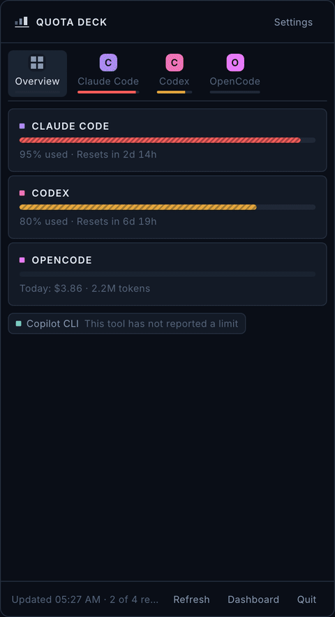
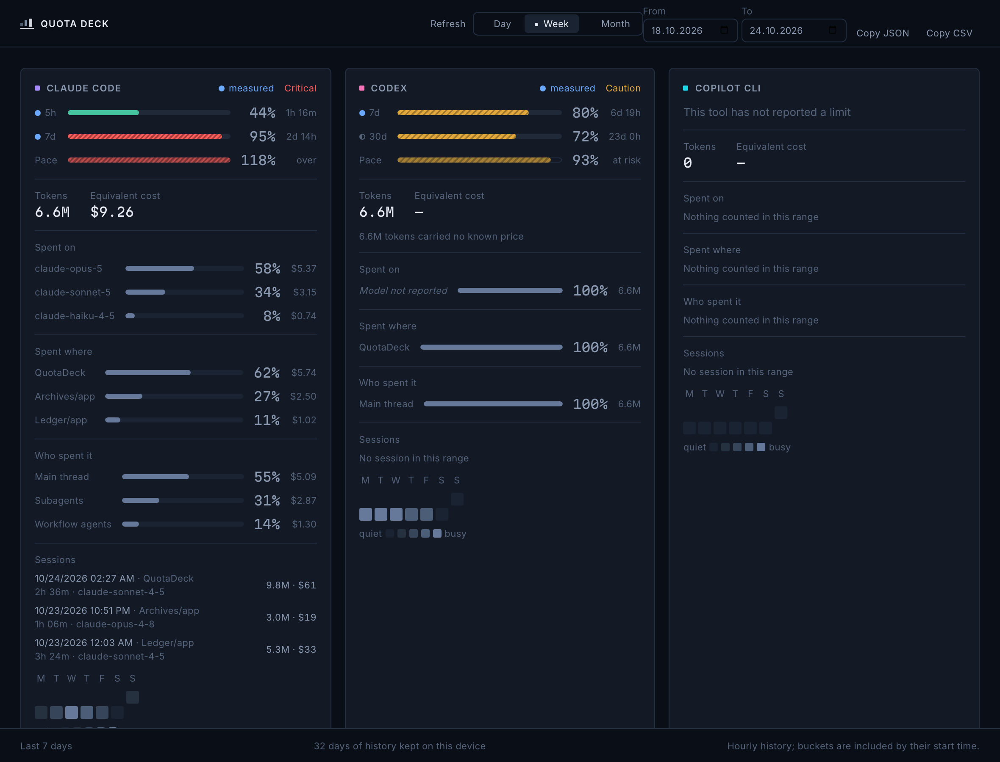

<div align="center">



<br>


<p>
  <a href="#-what-you-get"><b>Features</b></a> ·
  <a href="#-tools-it-reads"><b>Tools</b></a> ·
  <a href="#-how-it-works"><b>How it works</b></a> ·
  <a href="#-privacy-by-construction"><b>Privacy</b></a> ·
  <a href="#-command-line"><b>CLI</b></a> ·
  <a href="#-build-from-source"><b>Build</b></a>
</p>

</div>

---

Coding agents stop you mid-task when a five-hour window or a weekly ceiling runs out — and the only
place that number lives is a page you have to go and look at. **Quota Deck puts it in your menu bar.**

It reads the session logs your tools already write to disk, folds them into the limits each tool
enforces, and tells you how full every window is, when it lets go, and whether your current pace
gets you there. It never signs in, never reads a credential, and never makes a network request.

<table>
<tr>
<td width="46%" valign="top">



</td>
<td width="54%" valign="top">

### One glance, every limit

- **A tab per tool** with a hairline meter of its fullest window, and an **Overview** that puts
  them side by side.
- **Every window the tool reports** — five hours, a week, a month — each with *how much is used*
  and *when it frees up*.
- **Pace**, drawn as a projection and labelled as one: *"over (118%) · runs out 07:33"*.
- **The Horizon strip**: usage enters on the right and falls off the window edge as the quota
  comes back.
- **Cost**: today, the last 30 days and your cache hit rate, in equivalent API dollars.
- **The running session**, straight from Claude Code: how full its context window is and how long
  the prompt cache stays warm.

<sub>Recorded from the app's built-in demo data.</sub>

</td>
</tr>
</table>

## ✦ What you get

<table>
<tr>
<td width="33%" valign="top">

#### 🎯 Limits that mean something
Windows are classified by their **duration**, never by a key name, so a CLI release that renames
`primary` cannot shuffle your quotas. Each one shows used *or* remaining — your choice, applied to
the panel and the tray alike.

</td>
<td width="33%" valign="top">

#### 🔵 Measured, or clearly estimated
A filled mark means the tool stated the number itself. A hollow one means it was worked out here
from your plan. The two are never blurred — a guess presented as a reading is the fastest way to
lose trust in a tool like this.

</td>
<td width="33%" valign="top">

#### 🔔 Warnings you chose
Notifications at 70, 85 and 95% by default, once per limit per window. Mute them for an hour or
until tomorrow. A separate alert flags an hour of agent spend far past your usual one.

</td>
</tr>
<tr>
<td valign="top">

#### 📊 A dashboard for the why
Hourly history for 32, 90 or 365 days, a heatmap, and spend split three ways: **by model**,
**by project directory** and **by who ran it** — you, a subagent or a workflow. Plus your
**recent sessions**, each folded to one row.

</td>
<td valign="top">

#### 🧭 Quiet until it isn't
The menu bar item is a single monochrome glyph that only takes colour past 85%. Prefer a number or
a miniature timeline? Pick *compact* or *strip*. An opt-in hotkey — <kbd>⌘</kbd><kbd>⌥</kbd><kbd>Q</kbd>
— opens the panel from anywhere.

</td>
<td valign="top">

#### 🧩 Built for real setups
Two accounts of one tool stay two quotas (`codex#work`). Extra log folders fold into the same
quota. A macOS widget, JSON/CSV export, and a CLI for scripts. In English, Türkçe, Deutsch and
Español.

</td>
</tr>
</table>

## ✦ Tools it reads

| Tool | Where it reads | Limits | Cost | Status |
|---|---|---|---|---|
| **Claude Code** | `~/.claude/projects` + the optional status line | 🔵 Measured 5h and 7d via the status line; estimated from your plan before that | ✅ Embedded price table | Verified on real logs |
| **Codex** | `~/.codex/sessions` | 🔵 Measured — Codex writes its own rate limits | Tokens | Verified on real logs |
| **Copilot CLI** | `~/.copilot/session-state` | Exact ceiling from the published plan allowance | ✅ Metered by GitHub | Parser verified; the tool's new runtime stopped writing this file |
| **Gemini CLI** | `~/.gemini/tmp/*/chats` | — not written to disk | Tokens · priceable via override | Awaiting a real-log check |
| **OpenCode** | `~/.local/share/opencode/opencode.db` (SQLite, read-only) | — | ✅ Table, then OpenCode's own figure | Awaiting a real-log check |
| **pi / OMP** | `~/.pi/agent/sessions` | — | ✅ Table, then pi's own figure | Awaiting a real-log check |
| **Amp** | `~/.local/share/amp/threads` | — | ✅ Claude models | Awaiting a real-log check |
| **Droid** | `~/.factory/sessions` | — | ✅ Claude models | Awaiting a real-log check |

A tool that is not installed says exactly that. A tool that writes no limit shows its tokens and
cost and **no percentage** — nothing is synthesised for it. Tools that only expose usage through a
sign-in, a cookie or a web API (Cursor, Windsurf and the like) are left out on purpose.

> [!NOTE]
> The last five were written from the formats documented by open-source readers and are tested
> against synthetic fixtures. They graduate to *verified* once compared with a real install —
> see [`docs/USER_ACTIONS.md`](docs/USER_ACTIONS.md) §6.

## ✦ How it works

<div align="center">

</div>

<br>

The core is a Rust workspace that treats your disk as the only source of truth and its own memory
as a budget:

- **Never re-reads a log.** Every file has a byte-offset cursor; a quiet minute reads zero bytes.
  Files a tool rewrites whole, and OpenCode's database, are re-read only when their size or
  modification time changes.
- **Never double-counts.** Claude Code repeats records across resumed and forked sessions — 51% of
  rows on a real machine — so usage is deduplicated on `(message.id, requestId)`. Running totals
  are charged only their growth, cost included.
- **Never fails a whole file.** One corrupt line is reported and skipped; the rest of the file
  still counts.

| Budget, asserted in CI | Result |
|---|---|
| Cold parse of a 160 MB, 500-file corpus | **~76 ms** |
| Warm tick across 500 established cursors | **< 1 ms**, 0 bytes read |
| One hour of watching | reads exactly the bytes appended |
| Peak resident memory | **7 MB** |

## ✦ Privacy by construction

The obvious architecture — lift a provider's OAuth token out of the Keychain and call its usage
API — breaks the consumer terms of every provider it touches. Quota Deck is built so that it
*cannot* do that, and CI checks each rule on every push:

| Rule | How it is enforced |
|---|---|
| **No network requests** | No HTTP client in any dependency tree (`reqwest`, `hyper`, `ureq`, … grepped in CI). The macOS build carries no `network.client` entitlement. |
| **No listening sockets** | No `network.server` entitlement either. |
| **Credentials are never read** | Keychain, Credential Manager and provider auth files are never opened, listed or probed. Discovery looks up literal path segments directly, so even the *names* of files beside a log folder are not read. |
| **Logs are read-only** | Opened for reading; never written. OpenCode's database is opened read-only. |
| **The panel gets no filesystem** | All file access lives in Rust; the webview has no `fs` capability. |
| **The status line shim keeps counters only** | It copies `rate_limits` and an allow-list of numeric fields. `cwd`, `session_id`, `transcript_path` and `model` never reach disk. |

Analytics, crash reports, telemetry: none. There is nowhere for them to go.

## ✦ The dashboard

<div align="center">

</div>

## ✦ Command line

`quotadeckctl` answers the same questions in a shell. Data goes to stdout, diagnostics to stderr,
and `export` reports the deck's worst reading through its exit status, so a script can branch on
your quota without parsing a byte.

```console
$ quotadeckctl status --provider codex
$ quotadeckctl report daily --since 2026-10-18
provider       period                    tokens       cost
claude-code    2026-10-23             156402184     58.38
claude-code    2026-10-24             162364097     55.89
codex          2026-10-23               2471726      0.00+
+ includes tokens at an unknown price; the dollar figure is short by them

$ quotadeckctl report session --provider claude-code --json
$ quotadeckctl export --json            # exit 0 ok · 10 near · 11 hit · 20 unknown
```

<details>
<summary><b>All commands</b></summary>

| Command | What it does |
|---|---|
| `providers` | Compiled providers, their confidence level and roots |
| `status [--provider <key>] [--plan <id>]` | Parse the logs and print what each window reports |
| `report daily\|monthly\|session [--provider] [--since] [--until] [--json]` | Tokens and equivalent cost per local day, month or session |
| `export [--json\|--csv] [--provider] [--from --to]` | The whole deck to stdout, with a quota exit status |
| `config show` · `config validate` | The stored settings, and whether they resolve |
| `guard` | Resolved home, data directory and per-root access |
| `tray <key>` | Draw the menu bar item for a provider |
| `statusline preview\|install\|revert` | Connect Claude Code's status line — always chained, always revertible |

</details>

<details>
<summary><b>Pricing a model the table does not know</b></summary>

Costs come from an embedded, source-cited price table and are never fetched. For a model it does
not cover — Gemini, say — drop a `pricing-overrides.json` into the app's data folder (USD per
token):

```json
{
  "models": {
    "gemini-2.5-pro": { "input": 0.00000125, "output": 0.00001, "cacheRead": 0.000000125 }
  }
}
```

An invalid entry is skipped and named in the log rather than discarding the file, and on the next
launch the changed rates re-price the history already counted.

</details>

## ✦ Build from source

**Requirements:** Rust 1.82+, Node 20+, and the [Tauri 2 prerequisites](https://v2.tauri.app/start/prerequisites/) for your platform.

```bash
# The app
npm --prefix ui install
npm --prefix ui exec tauri -- dev          # run with hot reload
npm --prefix ui exec tauri -- build        # bundle for this platform

# The command line
cargo run -p quotadeck-cli -- status

# Everything CI checks
cargo fmt --all -- --check
cargo clippy --workspace --all-targets -- -D warnings
cargo test --workspace
cargo test -p quotadeck-core --release --test perf -- --ignored --test-threads=1
npm --prefix ui test
```

Platform packaging lives in [`scripts/`](scripts): the sandboxed Mac App Store build
(`appstore.sh`, `widget.sh`), signed Windows installers for the Microsoft Store (`msstore.ps1`)
and `.deb`, `.rpm` and AppImage for Linux (`linux.sh`).

<details>
<summary><b>Project layout</b></summary>

```text
core/        the read loop — cursors, dedup, buckets, pace, pricing, sessions (no provider names)
providers/   one file per tool + real or synthetic fixtures under tests/fixtures/<tool>/
app/         Tauri shell — tray, panel, dashboard window, alerts, widget snapshot, status line shim
cli/         quotadeckctl
ui/          React panel and dashboard
site/        the marketing site (Astro)
shared/      design tokens shared by the app and the site
docs/        discovery notes, release checklist, store notes, plans
```

Adding a tool is **one file, one fixture test and one line of registration** — nothing else in the
codebase learns its name.

</details>

## ✦ Status

Quota Deck is **pre-release**. The code is complete for the first version; what remains is
release work — signing, store listings and real-machine QA — tracked in
[`docs/RELEASE_CHECKLIST.md`](docs/RELEASE_CHECKLIST.md) and [`docs/USER_ACTIONS.md`](docs/USER_ACTIONS.md).
What was built and decided most recently is in [`docs/FINISH_PLAN.md`](docs/FINISH_PLAN.md) and
[`CHANGELOG.md`](CHANGELOG.md).

## ✦ License

Not yet licensed for reuse (`UNLICENSED`); all rights reserved. Bundled fonts — Inter and Martian
Mono — are under the SIL Open Font License, see [`licenses/`](licenses).

<div align="center">
<br>
<sub>Built by <a href="https://github.com/kutluhangil">@kutluhangil</a> · ReBuildReBreak</sub>
</div>
